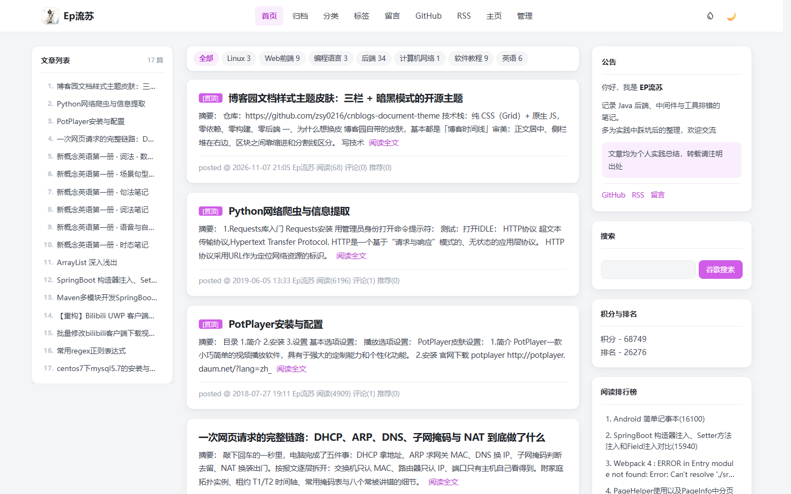
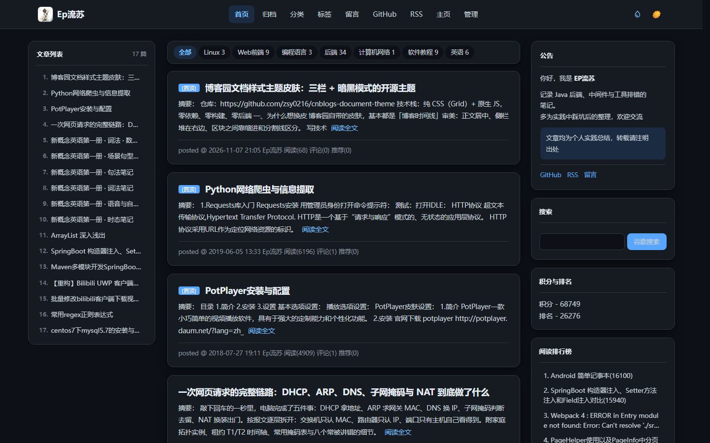
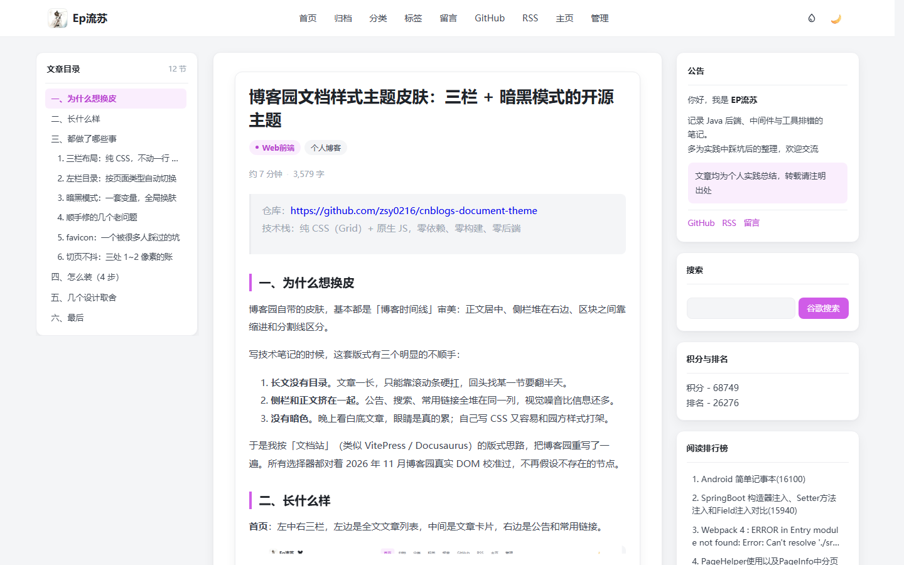
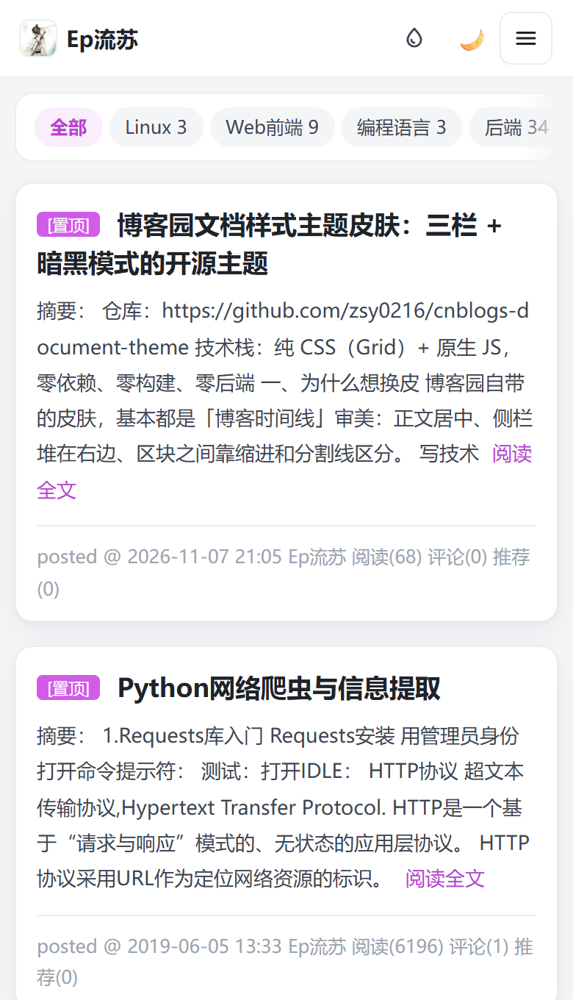
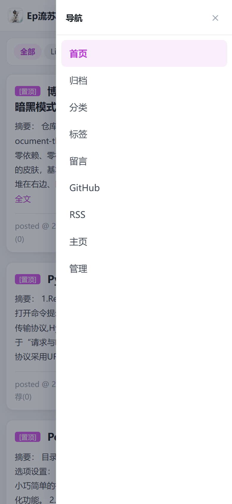

# cnblogs-document-theme · 博客园「文档风」主题

纯白卡片、左中右三栏、粉紫强调色、可定制顶栏、GitHub Dark 暗色模式。
纯 CSS（Grid）+ 原生 JS，零依赖、零构建；基于 2026-11 实测的博客园真实 DOM 重写，不假设不存在的节点。

- **三栏靠 CSS**：左栏文章列表/目录、中栏正文、右栏侧栏卡，首帧就是终态，切页不塌
- **左栏自动目录**：文章页按 H1–H4 生成，列表页生成文章索引，归档页生成年月胶囊
- **归档补成全站时间线**：博客园只有按月归档，主题把全部月份拼成一条线
- **暗色模式**：配色对齐 GitHub Dark，跟随系统或手动切换，选择记在本地
- **主题色可选**：顶栏调色按钮一键换 6 套强调色（紫/蓝/青/橙/绿/玫红），明暗各一套取值，互不干扰
- **文章页增强**：标题下自动算「约 N 分钟 · N 字」、标题悬停出锚点 `#`、文末自动附版权块
- **分类与标签**：文章页标题下「分类 + 标签」胶囊，列表页顶部分类筛选条（带篇数、当前项高亮）
- **手机上也能用**：左下角「目录」按钮拉出底部抽屉、宽表横滑且首列吸附、超长代码块自动折叠
- **为阅读收尾**：续读记忆（下次接着上次的位置）、打印/存 PDF 自动去外壳转白底黑字、暗色跟随系统实时切换
- **装的时候不用上传文件**：后台贴 CSS 与页首两个字段就完事，js 从仓库加载；换配色、改菜单直接改页首里的配置

## 效果预览

| 首页（浅色） | 首页（暗色） |
|:---:|:---:|
|  |  |

文章页（左侧根据正文 H1–H4 自动生成目录，标题下是分类与标签）：



手机（断点以下汉堡 + 右侧抽屉，条目与桌面菜单同源）：

| 列表 | 导航抽屉 |
|:---:|:---:|
|  |  |

## 谁在用

| 站点 | 备注 |
|:---|:---|
| [流苏的博客](https://www.cnblogs.com/zhangshuaiyin/) | 主题作者的站，每次改动先在这里跑 |

装完不用打招呼。但**欢迎[登记](docs/使用案例.md)** —— 填个地址就行，我会加进这张表。
反过来，想知道「别人装完长什么样、有没有踩坑」，也是看这张表。

## 安装

> ⚠️ **第 0 步（最重要）**：设置 → 皮肤 → 选择 **`Custom`（自定义）**，否则后续全部不生效。

**不用上传任何文件，也不用 fork。** 两个字段复制粘贴，五分钟装完：

| 步骤 | 贴到哪 | 贴什么 | 大小 |
|:---:|:---|:---|---:|
| 1 | 设置 → **页面定制 CSS 代码** | `dist/paste/样式.css` | 649 B |
| 2 | 设置 → **页首 HTML 代码** | `dist/paste/页首.html` | 5.9 KB |
| 3 | 设置 → **页脚 HTML 代码** | **全选删除，必须清空** | — |
| 4 | 设置 → **公告** | 全选删除（公告由脚本渲染；不删也行，会自动取原文） | — |

样式和脚本都由页首自己从 GitHub 仓库加载（jsDelivr 镜像，跟随 `@latest`）—— **不用你传、不用你打 tag、不用你改任何地址**。
CSS 字段里那 649 字节只是首帧闸门，不含样式本身；所以以后作者改配色、改布局、发新版，**你的字段一个字都不用动**。

### 具体怎么贴

> 动手前先做一件事：**页脚 HTML 代码 + 公告**两个字段 `Ctrl+A` → `Delete` → 保存。
> ⚠️ 不能省：页脚里若残留旧版内联脚本，它会自己建一套右栏、和新版同时跑，怎么贴都不对。

1. **贴 CSS（649 B）**
   页面定制 CSS 代码 → 全选删除 → 粘贴 `样式.css` 全文 → 保存。
   首行是 `html{--qb-field:2}`（给 js 的标记，别删），后面只有一条首帧闸门：
   结构齐之前 `body` 透明，脚本建完才解锁；样式/脚本挂了 2.5 秒自动放行。
   **完整样式不在这里** —— 由页首从 CDN 取，所以以后改样式不用回来重贴。

2. **贴页首（5.9 KB）**
   页首 HTML 代码 → 全选删除 → 粘贴 `页首.html` 全文 → 保存。
   内容只有五样：归档页标记、顶栏占位、`window.LS_CONFIG`（配置全留空）、样式外链、一段双源加载脚本。

   > 这个文件里**没有任何我的信息**：顶栏品牌取你页面标题里的博客名，菜单指向你自己的站，
   > 公告用你后台那份原文，连 favicon 都不碰。配置想改就改，不改也能跑。

3. **前台 `Ctrl + F5` 强刷**

### 为什么不用上传

页首里那段加载器，从两个地址各取一份 **样式** 和一份 **js**：

| 顺序 | 地址 | 说明 |
|:---:|:---|:---|
| 主源 | `gcore.jsdelivr.net/gh/zsy0216/cnblogs-document-theme@latest/…` | GitHub 仓库镜像，`@latest` 指向最新 tag |
| 备源 | `cdn.jsdelivr.net/gh/zsy0216/…@latest/…` | 同一 CDN 的另一节点，主源失败时自动接管 |

两个都在公网 CDN 上，`*.cnblogs.com` 和绑了自定义域名的博客都能取。主源失败会记进 `localStorage`，
一小时内直连备源，不会每次进站都等一遍超时。样式两个源都取不到时，`document-theme.js` 会把自带的
那份样式注进去 —— 所以 CDN 抖动最多是晚一点上色，不会变成没样式的裸页。

地址后面还会拼一个「当天日期」参数（`?d=20261117` 这种）：jsDelivr 给文件的缓存是浏览器 7 天、
边缘 12 小时，每天换一次 URL 才不会一直吃旧缓存 —— 所以发版后最迟次日所有站点自动生效。

「每个人上传一次文件」本来就没必要 —— 文件在 GitHub 上，谁都能读。

### 升级到新版本

**什么都不用做。** 页首取的是 `@latest`，作者推新 tag 后最迟次日自动生效：js 变了自动换，
样式变了也自动换，你后台那两个字段一个字都不用改。

只有一种情况需要动手：**想退回内联形态**（比如 CDN 在你那边不可用）。那就贴 `dist/paste/样式-内联备份.css`
（54 KB，含完整样式，`--qb-field:1`），同时把页首换回 tag `v7.30` 那一版（那一版不写样式外链）。

有没有新版看 [CHANGELOG](CHANGELOG.md) 或仓库的 Releases。

### 想自己控制版本（进阶）

上面那套用的还是我的仓库。要改源码、或不想依赖别人的仓库：

1. fork（或 clone）仓库，改完 push，并打一个与版本号同名的 tag：`git tag v7.31 && git push --tags`；
2. 把页首里 `var MIRROR` / `var FALLBACK` / `var CSS_M` / `var CSS_F` 四行的地址换成你的账号
   （前两个是 js，后两个是样式；`CSS_F` 只在主源失败时用）；
3. 也可以把 `dist/document-theme.js` 传到自己博客的「文件」，让 `FALLBACK` 指向
   `https://blog-static.cnblogs.com/files/blogs/<你的博客ID>/document-theme.js?v=<版本号>`。

两个坑，实测踩过：

- **别用 `@master`**：分支引用在 jsDelivr 各节点会长期缓存。push 完新版本，fastly / cdn 已回源，
  gcore 仍返回两周前的旧包；加 `?v=` 也无效（gcore 的缓存键不含 query），`purge.jsdelivr.net` 也清不动它。
  `@latest` 不一样：它由 CDN 端解析成最新 **tag**（tag 是不可变路径，缓存命中即是正确内容），
  解析结果 12 小时内刷新，配合页首的每日日期参数就够用了。
- **`blog-static` 只能当你自己的备源**：它对 Referer 只放行 `*.cnblogs.com`
  （2026-11-17 实测 `https://example.com/` 直接 403），绑了自定义域名的读者取不到。

### 装完怎么确认

打开任意页面 → `Ctrl+U` 看源码，四个关键词：

| 搜什么 | 期望 |
|:---|:---|
| `--qb-field` | 1 处（第 1 行） |
| `@view-transition` | 1 处 |
| `gcore.jsdelivr.net` | 1 处（主源） |
| `cdn.jsdelivr.net` | 1 处（备源） |
| `document-theme.js` | 2 处（主源 + 备源各一处） |
| `qb-right` | **0 处**（有的话说明页脚旧脚本没清干净） |

页面上看：左栏有内容、右栏有公告和搜索/积分/排行榜、顶栏 59px、页脚末行有 `Theme powered by cnblogs-document-theme`。
逐项验收清单与排错表见[安装-详解](docs/安装-详解.md)。

<details>
<summary>想彻底不发外部请求？三字段全内联（备选）</summary>

先跑 `python _dev-tools/gen-deploy.py --mode inline` 生成四份，再贴 CSS / 页首 / 页脚三个字段（公告清空）。
页面不发出任何主题请求，代价是**每次改脚本要重贴 37 KB 页脚**。

完整步骤见[备选-内联安装](docs/备选-内联安装.md)。

</details>

## 配置项

**配置写在哪**：页首字段里那段 `window.LS_CONFIG = { ... }`（安装第 2 步贴进去的内容，开头带一大段注释的就是它）。改完保存，前台 `Ctrl+F5` 即可看到效果，不用碰源码、不用重传文件。

安装包里这个对象**是空的**（三块可选项都是注释），全部留空时脚本按当前站点推导：品牌名取页面标题里的博客名，
菜单指向你自己的站，公告用你后台那份原文。下面的完整写法只是「有这些键可用」，用到哪块放开哪块，不必全抄。

```js
window.LS_CONFIG = {
  accent: '#d05ce8',        // 强调色
  dark: 'auto',             // 'auto' 跟随系统 | 'on' | 'off'
  code: {
    lineNumbers: true,      // 代码块行号（有 Prism 行号时用园方的，没有才自己画）
    copy: true              // 右上角复制按钮
  },
  nav: {
    brand: '你的博客名',
    home: 'https://www.cnblogs.com/你的博客名/',
    logo: 'https://…jpg',   // 留空则只显示文字与图形标记
    links: [
      { t: '首页', h: 'https://www.cnblogs.com/你的博客名/' },
      { t: '归档', h: 'https://www.cnblogs.com/你的博客名/p/archive/{ym}' },
      { t: 'GitHub', h: 'https://github.com/你的账号', b: 1 }   // b:1 = 新窗口
    ]
  },
  notice: {
    title: '公告',
    html: '<p>你好，我是 <b>你的名字</b></p>'
  }
};
```

| 键 | 默认 | 说明 |
|:---|:---|:---|
| `accent` | `''` | 强调色，如 `#d05ce8`。留空沿用 CSS 里的值；`--accent-deep` 与 `--accent-soft` 自动派生 |
| `dark` | `'auto'` | `auto` 跟随系统 / `on` 默认暗色 / `off` 默认浅色。用户手动点过开关后以他的选择为准 |
| `backToTop` | `true` | 右下角回到顶部按钮（带阅读进度环） |
| `pager` | `true` | 列表页分页整理（隐藏上方那份，只留下方一条） |
| `archive` | `true` | 归档页聚合成全站时间线 |
| `archiveTtl` | `24` | 归档单月缓存有效期（小时）；篇数一变仍会立即失效 |
| `code` | `{ lineNumbers: true, copy: true }` | 代码块行号与复制按钮。`lineNumbers:false` 去行号（园方那套也一起收），`copy:false` 去按钮，`code:false` 整块不加工 |
| `nav` | **按当前站点自动生成** | 顶栏。`{ brand, home, logo, mark, dark, links: [{ t, h, b, on }] }`，`links` 整体替换 |
| `notice` | **博客园「公告」字段原文** | 公告。`{ show, title, html }`；`show:false` 隐藏，`html:''`（默认）用后台公告字段 |

### 不配也能用（v7.18 起）

默认值不再写死任何人的博客，而是按**当前站点**推导：

- 站点根路径取当前地址的第一段（`/<你的博客名>/`），首页、分类、标签、RSS 都由它拼出来；
- 顶栏品牌名取页面标题里的博客名（博客园标题固定是「页面名 - 博客名 - 博客园」）；
- 归档指向**当月**（`/p/archive/当年/当月`，因为 `/p/archive/` 根路径是 404）；
- 公告用博客园后台「公告」字段的原文，不内置任何人的文案。

也就是说，把配置对象整段删成 `window.LS_CONFIG = {}` 也能正常跑，顶栏和公告都会指向你自己的博客。想加「留言 / GitHub / 管理」这类个人链接时，才需要在 `links` 里显式写出来。

`nav.links` 每条：`t` 文字、`h` 地址、`b` 新窗口、`on` 强制高亮（默认按当前地址自动高亮）。
`h` 里的 `{ym}` / `{y}` / `{m}` 会展开成当前年月，归档这一类带年月的地址不用每月手改。
公告的 `.qb-notice-tip` / `.qb-notice-links` 是内置样式类，颜色走变量，暗色自动跟随。
菜单与 logo 的完整写法见[自定义顶栏](docs/自定义顶栏.md)。

优先级：**内置默认值 < `LS_CONFIG` < 用户手动选择（仅暗色一项）**。`nav` 与 `notice` 支持逐项覆盖，只写想改的键即可。

> **命名说明**：`LS` = 流苏（LiuSu）的拼音首字母。v6.29 及以前叫 `window.QB_CONFIG`，两个名字等价，
> **同时写时 `LS_CONFIG` 优先**，老配置一个字都不用改。
> 反过来说，`LS_CONFIG` 里**不要写与默认值相同的键**（例如 `accent: ''`）—— 它会把
> `QB_CONFIG` 里的同名设置整个吞掉。页首模板里 `accent` 与 `code` 因此留成注释，用到再放开。
> CSS 类名（`.qb-nav` / `.qb-pager`…）和 `localStorage` 键（`qb-dark`、`qb-arc-v3:`）仍是 `qb-` 前缀，
> 升级不会丢用户已存的暗色选择和归档缓存。

## 文档

| 文档 | 内容 |
|:---|:---|
| [安装-详解](docs/安装-详解.md) | 验收清单、排错表、切页不闪的逐帧实测与修法 |
| [备选-内联安装](docs/备选-内联安装.md) | 不上传文件、三字段全内联的装法与排错 |
| [自定义顶栏](docs/自定义顶栏.md) | 菜单、logo、favicon、顶栏样式 |
| [布局与左栏目录](docs/功能-布局与目录.md) | 三栏原理、适配页面、左栏目录、一篇一卡、右栏精简 |
| [归档时间线](docs/功能-归档时间线.md) | 归档总览页怎么补出来、缓存新鲜度、侧栏异步的稳定性处理 |
| [分页与滚动](docs/功能-分页与滚动.md) | 列表页分页整理、吸顶行为、回到顶部按钮 |
| [代码块](docs/功能-代码块.md) | 行号归属（园方 Prism / 主题自建）、语言标签、复制、为什么不显示 |
| [文章页增强](docs/功能-文章页增强.md) | 阅读时长算法、标题锚点为何不能写文字、版权块取哪些值、主题色面板 |
| [分类与标签](docs/功能-分类与标签.md) | 原生分类/标签块为何拿不到、keywords 抽分类、列表页筛选条、缓存与降级 |
| [移动端与阅读](docs/功能-移动端与阅读.md) | 导航与目录抽屉、宽表横滑与首列吸附、代码折叠、续读记忆、打印样式、Markdown 元素补全 |
| [开发指南](docs/开发指南.md) | 源码结构、构建与版本管理、压缩、验证脚本、文件清单 |
| [使用案例](docs/使用案例.md) | 谁在用这套主题、怎么登记、收录标准 |
| [推广文](docs/promo-post.md) | 发到博客园 / CSDN 的介绍文章（配图 + 安装步骤） |

本地 `preview/home-v7.html` / `preview/post-v7.html` 是离线预览页（线上 DOM + 主题 CSS 合成），可直接用浏览器打开看效果。

## 回滚

清空「页面定制 CSS 代码」「页首 HTML 代码」「页脚 HTML 代码」三个字段，即恢复博客园默认外观。
旧版 v6.28 已封存在 tag `v6.28`，需要时从仓库取出重贴。

## 许可

[MIT](LICENSE) —— 商用、二改、再发布都可以，**法律上不要求署名**。

**但页脚有一行是写死的**：`Theme powered by cnblogs-document-theme ↗`，链回仓库。
它在 js 里，配置对象里没有对应的键 —— 写 `credit: false` 不生效，界面上也没有开关。

这是「让人敢用」和「让下一个人找到它」之间的一个选择：默认留着，不需要使用者做决定。
真不想要就 fork 之后删掉 `initCredit()` 里那一行，重新生成 js 即可，MIT 允许。
（说明白：任何前端代码都锁不住，这里也没打算锁 —— 所谓写死，只是不给开关。）

> 数据边界顺便说清：主题代码里没有发往作者服务器的请求，也没有埋点。
> 走 jsDelivr 镜像时下载量会计入 [jsDelivr 公开统计](https://data.jsdelivr.com/v1/stats/packages/gh/zsy0216/cnblogs-document-theme)，
> 那是 jsDelivr 的计数，不是我加的追踪。
