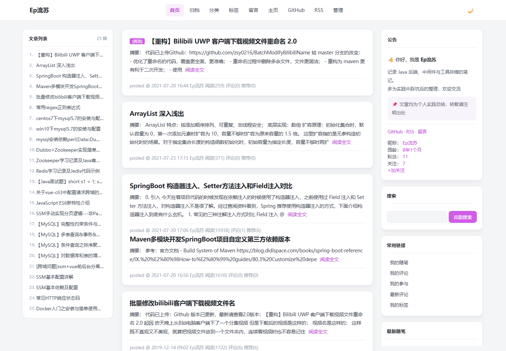
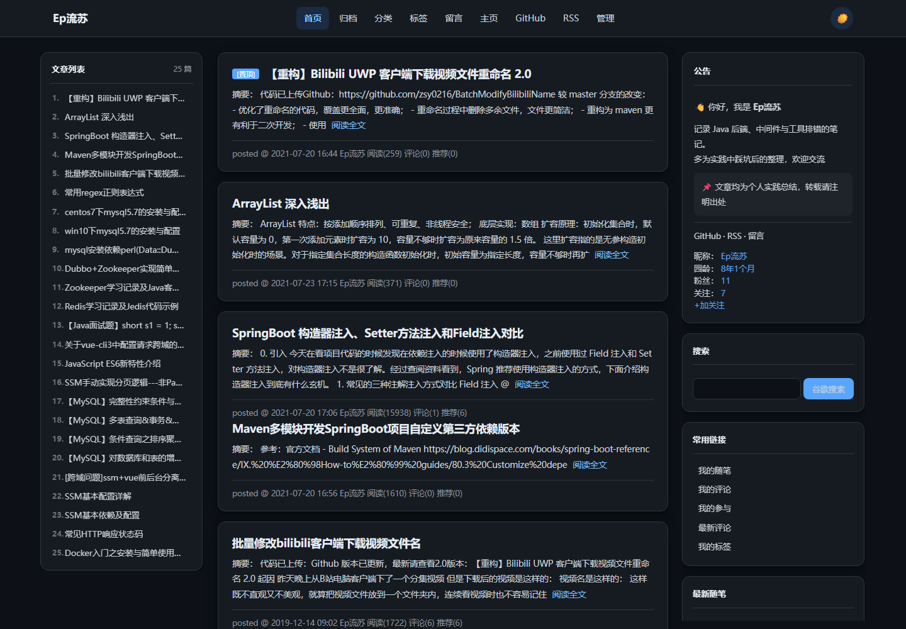
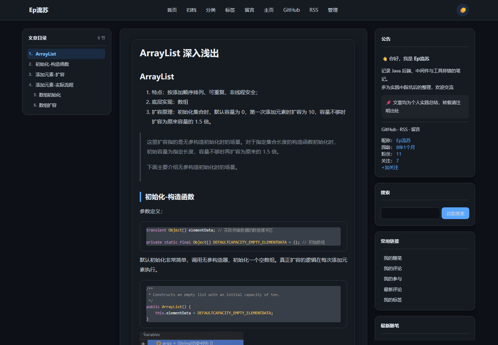

# cnblogs-document-theme · 博客园「文档风」主题

> 纯白卡片、左中右三栏、粉紫强调色、可定制顶栏、GitHub Dark 暗色模式。
> 基于 2026-11 实测的博客园真实 DOM 重写，不再假设不存在的节点。
> 纯 CSS（Grid）+ 原生 JS，零依赖、零构建。

## 效果预览

| 首页（浅色） | 首页（暗色） |
|:---:|:---:|
|  |  |

文章页（暗色，左侧自动生成 H1–H4 目录）：



## 安装（4 步）

> ⚠️ **第 0 步（最重要）**：设置 → 皮肤 → 选择 **`Custom`（自定义）**，否则后续全部不生效！

1. **页面定制 CSS 代码** → 全选**替换为 `css/theme-v6.min.css`（30.7KB，比源文件 -36%）** → 保存
2. **页首 HTML 代码** → 粘贴 `snippets/head-nav-v6.html`（3.5KB）→ 保存
3. **页脚 HTML 代码** → 粘贴 `snippets/footer-script-v6.min.html`（25.9KB，需先清空）→ 保存
4. **公告** → 粘贴 `snippets/announcement-v6.html`（0.9KB）→ 保存
5. 前台 `Ctrl+F5` 强刷

> 本地 `preview/home-v6.html` / `preview/post-v6.html` 是离线预览页（把线上 DOM + 主题 CSS 合成），可在本地直接打开看效果，不算服务。

## 定制顶栏

只需改 `snippets/head-nav-v6.html` 里的 `.qb-links`：

```html
<nav class="qb-links">
  <a class="on" href="https://www.cnblogs.com/zhangshuaiyin/">首页</a>
  <a href="https://www.cnblogs.com/zhangshuaiyin/p/archive/2021/07">归档</a>
  <a href="https://www.cnblogs.com/zhangshuaiyin/categories">分类</a>
  <a href="https://www.cnblogs.com/zhangshuaiyin/tag">标签</a>
  <a href="https://msg.cnblogs.com/send/Ep%E6%B5%81%E8%8B%8F">留言</a>
  <a href="https://home.cnblogs.com/u/zhangshuaiyin">主页</a>
  <!-- 加一项：复制一行改 href 与文字；删一项：删整行 -->
</nav>
```

博客园有效页面 URL（实测 200）：

| 菜单 | 格式 | 示例 |
|:---|:---|:---|
| 首页 | 博客名主页 | `https://<name>/` |
| 归档 | `/p/archive/` | `https://<name>/p/archive/` |
| 分类 | `/categories` | `https://<name>/categories` |
| 标签 | `/tag` | `https://<name>/tag` |
| 留言 | `https://msg.cnblogs.com/send/<名>` | 站内信 |
| 主页 | 管理页 | `https://home.cnblogs.com/u/<name>` |
| 管理 | 后台设置 | `https://i.cnblogs.com/settings/` |

- 当前页高亮：给对应 `<a>` 加 `class="on"`
- 不要顶栏：删掉整段 `<div class="qb-nav">…</div>`
- 顶栏样式在 `theme-v6.css` 的「2. 自建顶栏」段，改 `.qb-nav` 即可
- 顶栏右侧增加 **暗黑模式开关**（🌙/☀️），点击切换，设置保存在 `localStorage`，刷新保持
- 暗色配色对齐 **GitHub Dark**（底色 `#0d1117`、卡片 `#161b22`、描边 `#30363d`、正文 `#c9d1d9`、强调色 `#58a6ff`）

### 品牌区 logo

`.qb-brand` 里可以放任意多个 `.qb-logo`，CSS 对图片和内联 SVG 两种内容都做了适配，所以「图 + 名字 + 装饰」并排是合法的：

```html
<a class="qb-brand" href="https://www.cnblogs.com/zhangshuaiyin/">
  <span class="qb-logo">
    
  </span>
  <span class="qb-brand-text">Ep流苏</span>
  <span class="qb-logo" aria-hidden="true">
    <svg viewBox="0 0 32 32"><!-- 见 head-nav-v6.html 完整代码 --></svg>
  </span>
</a>
```

- **只用图片**：删掉最后一个 `qb-logo`，把 `img` 的 `src` 换成自己的图
- **只用 SVG**：删掉带 `img` 的那个 `qb-logo`；笔画用 `stroke="currentColor"`，hover 变强调色时会跟着变，不用额外写规则
- **改大小**：`.qb-logo` 的 `width` / `height` / `flex-basis` 三个值保持一致（默认 30px，小屏 24px）
- **改点缀色**：`.qb-logo .qb-logo-dot` 的 `fill`（暗色单独一档在 `body.qb-dark` 下）
- **间距**：元素间距统一由 `.qb-brand` 的 `gap` 控制（默认 9px）
- 小屏（≤860px）顶栏菜单改为**横向滑动**，logo 与暗黑开关固定不动；不要在 `.qb-links` 上加 `flex-wrap`，会把顶栏撑成两行

### 自定义浏览器标签图标（favicon）

在 `snippets/head-nav-v6.html` 里改这一行即可：

```html
<link rel="icon" href="https://你的图床/图标.png" />
```

支持 `png / ico / svg / jpeg`。**只需要一行**，不要重复贴 `shortcut icon` + `icon` 两行。

原理与注意事项：

1. 博客园会把页首 HTML 塞在 **body 里的 `#page_begin_html`**，浏览器只认 `<head>` 里的 `<link rel=icon>`，
   所以页脚脚本会自动把它搬进 `<head>`。
2. 博客园自己会往 `<head>` 写 `favicon_v3_3.ico` / `.svg` 两个默认图标，脚本会把它们清掉，
   并用 MutationObserver 持续拦截（园方脚本可能在页面加载后几秒再塞回来）。
3. 脚本会给图标地址追加 `?v=6.20` 绕过浏览器 favicon 缓存。**换图后如果没变化，把页脚脚本里的
   `FAV_VER` 改成 `6.21` 再保存，或 Ctrl+F5 强刷。**
4. 建议用 **正方形 PNG（32×32 或 64×64）**。JPEG 没有透明通道，深色标签栏上会出现白底方块，
   而且小尺寸下边缘会糊。


## 适配页面

标签页（`/tag`）、分类页（`/categories`）、归档页（`/p/archive/`）的容器现在也被**统一卡片化**，和首页文章列表一样显示：
- 卡片白底、1px 分割线、圆角、悬浮阴影
- 归档页会把**全站所有月份**的文章拼成一条时间线（见「归档页：从一个月补成全站时间线」），点击标题可跳转
- 标签页改标签色，分类页改分类色，悬浮粉紫高亮

页面右下角新增了 **回到页首** 按钮，滚动超过 300px 后自动出现（怀抱中 → 向下箭头），点击平滑滚动回顶部。

## 左栏目录

以下页面类型默认生成左侧文章列表/目录：

| 页面 | 左侧目录 | 样式 |
|:---|:---|:---|
| 首页 | 每篇标题 + 日期 | 卡片白底 |
| 文章详情 | 正文标题（H1-H4） | 专栏目录 |
| 标签列表 | 标签名（标签页） | 胶囊按钮 |
| 分类列表 | 分类名（分类页） | 分类条 |
| 归档列表 | 全部归档（年/月胶囊索引） | 胶囊按钮 |
| 标签文章页 | 文章标题 | 卡片白底 |
| 分类文章页 | 文章标题 | 卡片白底 |
| 归档文章页 | 全部归档（年/月胶囊索引） | 胶囊按钮 |

流程：进入页面 → `boot()` → `left` 非空 → 有正文就写文章目录，否则归档页写全年月索引，其他页面写文章列表。

### 排版细节

| 问题 | 处理 |
|:---|:---|
| 编号和标题贴在一起，两位数的 `10.` 会顶到标题上 | 编号列固定 `width:24px` + `text-align:right`，标题 `padding-left:32px`，数字宽度不同也竖直对齐 |
| 列表超出高度后，最后一行被切成半个字 | 脚本判定真的溢出（`scrollHeight - clientHeight > 4`）才加 `.qb-scroll`，底部 18px 渐隐 |
| 标题自己带「一、」「1.」时，目录里出现双编号（`5. 1. 三栏布局`） | `NUM_HEAD` 正则识别编号前缀，命中就加 `.qb-nonum`，不再叠加目录序号 |

`NUM_HEAD` 覆盖的写法：`1.` `1.2` `（二）` `一、` `第三章` `Step 2` / `Chapter 2` / `Part 2`。只作用于**文章目录**，列表页的文章标题照常编号。

`.qb-scroll` 只在溢出时出现，所以短列表（几行）不会把最后一项淡掉。

### 一篇一卡：同日多篇拆分

博客园的列表页把**同一天发布的多篇文章塞进同一个 `.day`**，靠 `.postSeparator` 分隔（`dayTitle` 是日期标题，后面依次是这个日期的第 1、2、3… 篇）。本主题把 `.day` 当卡片，碰上「一天发二十篇」时就变成一张两三千像素高的巨卡，标题、摘要、作者行周期性重复 —— 看起来完全像样式错乱。实测首页 7 个 `.day` 里，最大的那个高 2447px、装了 20 篇。

页脚脚本 `splitDayGroups()` 按 `.postSeparator` 把子节点重新分组，每组包一层同 class 的 `.day`：

```js
[].slice.call(day.childNodes).forEach(function (n) {
  if (n.nodeType === 1 && n.classList.contains('postSeparator')) { groups.push([]); return; }
  groups[groups.length - 1].push(n);
});
```

- 只处理含 **2 个以上 `.postTitle`** 的分组，单篇容器不碰
- 拆出来的卡片带 `data-qb-split="1"`，函数幂等，可以重复调用
- `boot()` 里紧跟 `hoistNav()` 执行（后面的文章目录要按拆分后的顺序取），侧栏兜底轮询里再调一次，兜住分页/懒加载追加的分组

实测：7 个 `.day`（最大 2447px）→ 27 个（141~190px），`.postTitle` / `.postDesc` / 链接数前后都是 27，无丢失无重复。

### 归档页：从「一个月」补成全站时间线

博客园**没有归档总览页**，归档只有 `/p/archive/YYYY/MM` 这种按月地址，顶栏「归档」的链接又写死了某一个月 —— 点进去永远只有那一个月的内容，很容易被当成页面坏了。

主题在归档页做了四件事：

1. 从左栏「随笔档案」读出**全部月份与篇数**（如 `2021年7月(4)`），这就是官方给的权威月份索引
2. 在正文位置拼成 **年 → 月 → 文章行** 的时间线，左栏换成月份胶囊索引
3. 月份页面**滚动到附近才抓**，单月结果按 24 小时本地缓存
4. 地址与标题统一成「全部归档」语义（见下）

```
全部归档   56 篇 · 10 个月 · 2018-07 → 2026-11
├ 2026   [11月 1]
├ 2021   [7月 4]
├ 2019   [12月 31] [10月 1] [6月 9]
└ 2018   [12月 2] [11月 4] …
```

左栏胶囊默认高亮**最新月**（与规范化后的地址一致），点哪个就亮哪个；正文里对应月份的月份名同步变色。

### 为什么地址栏不是 `/p/archive`（改不了，但能消歧）

博客园只有 `/p/archive/YYYY/MM` 一种归档路由，任何「总览」地址实测都是 404，而且 404 页不注入用户的页首/页脚脚本：

| 地址 | 实测结果 |
|:---|:---|
| `/p/archive`、`/p/archive/` | 404（974 字节，无用户脚本） |
| `/p/archive.html`、`/p/archive/all` | 404 |
| `/p/archive/2019`（只到年） | 404 |
| `/p/archive/2026/11?view=all` | **200 正常**（query 不影响） |

所以主题的做法是：页面跑起来后用 `history.replaceState` 把地址统一成 **最新月 + `?view=all`**，并把 `document.title` 改成「全部归档 - 博客名」。

- 不再是 `2021/07` 这种会误导人的历史月份
- 地址仍然指向**真实存在的页面**，刷新、分享、收藏都不会 404
- 想加参数或换月份，改 `normalizeArchiveUrl()` 里的 `u.search = '?view=all'`
- 代价：地址只表达「从哪里进入全部归档」，无法表达「这是总览页」——那是博客园路由的限制，不是主题能绕过的

### 文章变多会不会撑不住

会，但主题按「按月分片」处理过了。关键点是：**只有一个月一个请求**，而请求是滚动到附近才发的。

| 规模 | 月数 | 首屏请求 | 滚到底累计 | 本地缓存 |
|:---|:---|:---|:---|:---|
| 现在 56 篇 | 10 | **4** | 10 | 每月一条，24h |
| 200 篇 | ~36 | 3~5 | 36 | 同上 |
| 1000 篇 | ~120 | 3~5 | 120 | 同上，约 250KB |

实现要点：

| 事项 | 做法 |
|:---|:---|
| 懒加载 | `IntersectionObserver` + `rootMargin: 600px`，月块进视野才请求；未加载的月按篇数预留高度（`n × 30px`），否则十几个月份会挤在首屏、一次点亮全部请求 |
| 并发闸门 | 最多 4 个在飞，其余排队（`arcQueue(4)`），快速滚动不会瞬间打出几十个请求 |
| 缓存粒度 | `localStorage` 键 `qb-arc-v2:<博客地址>:<YYYY-MM>`，24 小时过期。**按月存**，发一篇新文章只会让最新那个月失效 |
| 失败隔离 | 单月失败只影响那一月，显示「打开该月 · N 篇 ↗」；点左栏索引可重试。整页不会回退成单月列表 |
| 旧缓存 | 上一版整站快照 `qb-arc-v1:*` 会被 `clearArcCacheV1()` 顺手删掉 |
| 无 IO 的浏览器 | 直接全量加载，行为与旧版一致 |
| 单月页分页 | 博客园按月归档不分页（实测 2019/12 的 31 篇全在一页），无需翻页 |
| 顶栏「归档」 | 脚本按月份索引把 href 改成**最新月份**，以后发文不用再手改 |
| 幂等 | 页面已存在 `.qb-archive` 时直接返回，页脚贴两遍也不会叠出两份时间线 |

实测（线上，1440×900，清空缓存）：首屏 4 个请求、37 条文章；滚到底再补 6 个请求，合计 56 条 / 10 个月；二次进入 **0 请求**（全部命中单月缓存）；人为拦截所有月份请求时，10 个月份小节 + 10 个胶囊 + 10 个「打开该月」入口全部正常，页面不塌。

想再省一半请求，可以把 `rootMargin` 从 `600px` 调小到 `200px`；想让滚动更顺，调大到 `1000px`（首屏会多抓 1~2 个月）。

改样式：`.qb-archive`（容器）、`.qb-arc-yhd`（年份）、`.qb-arc-mo`（月份小节）、`.qb-arc-link`（文章行）、`.qb-arc-pend`（未加载占位）、`.qb-arc-idx-*`（左栏索引）。只想恢复博客园原来的单月列表，删掉 `boot()` 里的 `buildFullArchive()` 调用即可。

### 稳定性：侧栏是异步的，不能等不到就回退

**现象**：同一个归档页刷几次，有时是完整时间线，有时退回博客园原生的单月列表（只有 4 篇）、地址也回到 `/p/archive/2021/07`。

**根因**：全部月份索引来自侧栏小部件「随笔档案」（`#sidebar_postarchive`），而它是**异步注入**的 —— 页脚脚本先执行、小部件后到是常态。旧逻辑一读不到月份就 `return false`，紧接着 `buildPostList()` 把左栏占成「文章列表」，之后再没有重试，于是永久回退。网络快慢不同，就表现为「时好时坏」。

**现在的处理**：

| 环节 | 做法 |
|:---|:---|
| 等待期 | 读不到月份不判死，`waitArchiveReady()` 每 200ms 轮询，最长 12 秒；左栏先显示「全部归档 / 读取中」占位，避免出现「左栏空白 + 正文只有 4 篇」的假故障观感 |
| 到位即建 | 月份索引一出现立刻构建时间线，并把占位面板替换掉（不会出现两份左栏） |
| 已回退也能自愈 | `boot()` 里 6 秒内的兜底轮询会调 `retryFullArchive()`：清掉脚本自己建的面板再重建，顶栏「归档」链接也同步修正 |
| 真的没有 | 12 秒仍未读到才回退成 `buildPostList()`，并清掉占位与所有脚本面板，只留一份「文章列表」 |

实测 6 次不同延迟（0 / 400 / 900 / 1800 / 3000ms，模拟侧栏晚到）：**全部稳定建成时间线**，左栏恒为 1 个面板、无重复。侧栏永久缺失时 12 秒后回退，仅 1 个面板、无「读取中」残留。

> ⚠️ **前提**：博客园后台「设置 → 侧边栏设置」里必须保留**「随笔档案」**小部件。它是月份索引的唯一来源，关掉之后本页会在 12 秒后退回单月列表。

自检：在归档页按 `Ctrl+U` 搜 `buildFullArchive`，搜得到就说明脚本已部署；再看页面首屏是否出现「全部归档 · N 篇 · N 个月」。

## 列表页分页

博客园的列表页会在**文章上下各渲染一份分页**，而且第一页只输出一个孤零零的「下一页」：

| 页面 | 上方 | 下方 |
|:---|:---|:---|
| 首页 / 随笔列表 第 1 页 | 无 | `#nav_next_page`，只有一个「下一页」，没有页码、没有当前位置 |
| 首页 / 随笔列表 第 2 页起 | `#homepage_top_pager` 完整页码 | `#homepage_bottom_pager` 完整页码；另有一个**空的** `#nav_next_page` |
| 分类 / 标签 / 归档月页 | 偶尔有空 `.pager` | 同上 |

现在统一成：**上方那份隐藏，只留下方一条**，并且两边页脚对齐。

| 处理 | 实现 |
|:---|:---|
| 认出「上方那份」 | 不写死 id，用位置判断：`firstArt.compareDocumentPosition(unit) & 4` 为假即位于首篇文章之前，打 `.qb-pager-top` 隐藏 |
| 空壳分页 | 园方没分页时仍输出空 `.pager` / 空 `#nav_next_page`，会白留 44px；文本为空直接 `display:none` |
| 空条不留线 | 整条 `.qb-pager-bar` 里没有可见分页时打 `data-qb-empty`，连上边框一起隐藏 |
| 当前页码 | 园方把当前页写成**裸文本节点**（`<div class="pager">…2…</div>`），CSS 选不中，用 `enhancePager()` 包成 `<span class="qb-cur">`，才上得了实心底色 |
| 首末页对称 | 第一页没有「上一页」、末页没有「下一页」，补 `.qb-dis` 灰色占位，否则一排按钮会左右歪 |
| 第一页补页码 | 第一页只输出一个「下一页」，补出「‹ 上一页（禁用）｜1｜下一页 ›」，与后面几页视觉连续 |

样式：34px 高的圆角按钮，当前页实心强调色（浅色紫 `#d05ce8` / 暗色蓝 `#58a6ff`），`hover` 上浮 1px，移动端降到 30px。想恢复博客园原样式，删掉 `boot()` 里的 `enhancePager()` 调用即可（`.qb-pager-top` 的隐藏也会随之失效）。

> **为什么第一页不补出 1 2 3 4 的完整页码**：博客园这一页的分页是按「天」分组切的，不是按篇数切 —— 实测第 1~4 页分别 17 / 15 / 15 / 11 篇，第一页既没有总条数也没有总页数；后续页用的是窗口式分页（第 2 页只给出 `1 2 3 4`），从任何一页都推不出真实末页。硬算总页数会算出 5、6 页这种不存在的页，所以第一页只做「当前位置 + 下一页」。

## 滚动行为

| 区域 | 行为 | 实现 |
|:---|:---|:---|
| 顶栏 `.qb-nav` | 吸顶，始终可见 | `position:sticky; top:0` |
| 左栏 `#leftcontentcontainer` | 吸顶，内容超高时内部滚动 | `position:sticky; top:74px; max-height:calc(100vh - 96px)` |
| 右栏 `#qb-right` | **跟随页面滚动**，不吸顶 | 普通文档流 |

顶栏吸顶有个坑必须靠 JS 解决：

```js
function hoistNav() {
  var nav = document.querySelector('.qb-nav');
  if (nav.parentNode !== document.body) document.body.insertBefore(nav, document.body.firstChild);
}
```

博客园会把页首 HTML 塞进 `#page_begin_html` 容器，而这个容器的高度**就等于顶栏自身高度**——`position:sticky` 找不到可吸附的行程，滚一屏就跟着页面一起滚走（表现为「写了 sticky 却不起作用」）。把顶栏提升为 `body` 的直接子元素，吸附范围才等于整页。`hoistNav()` 在 `boot()` 第一步执行，早于任何按视口测量的逻辑。

配套：`html { scroll-padding-top: 74px }`，否则点目录或 `#hash` 跳转时目标标题会被压在顶栏下面。

## 回到顶部

右下角 44px 圆形按钮，滚过 300px 才淡入。图标是 inline SVG 的上箭头（Lucide `arrow-up` 的路径：`M12 19V5` + `M5 12l7-7 7 7`），外圈套一圈**阅读进度环**。

旧实现是用 `border-right` + `border-bottom` 转 −45° 画箭头，问题是那条「拐角」只有两个折边、没有竖杆，指向也偏右上，缩到 10px 像个逗号。SVG 线条在任意尺寸下都清晰，还能直接改 `stroke-width`。

| 细节 | 取值 | 理由 |
|:---|:---|:---|
| 按钮尺寸 | 44 × 44 | WCAG 建议的最小触控目标；移动端再收到 `right:16px / bottom:20px` |
| 箭头 | 18px，`stroke-width:2.1`，圆头圆角 | 24 的 viewBox 缩到 18 时线宽会变 1.5px 显细，略微加粗补回来 |
| 进度环 | `r=18.5`，周长 116.24 | 比按钮内沿缩进 1.5px，和 1px 边框之间留缝，不会叠成「双圈」 |
| 环轨道 | `stroke: var(--line)` | 没读满的部分也有淡淡一圈，不至于悬空半截 |
| 进度算法 | `pageYOffset / (scrollHeight - innerHeight)` | `rAF` 节流，滚到底刚好闭合；文章页、归档页高度变化时自动重算 |
| hover | 上浮 2px + 箭头变强调色 + 阴影加强 | **不改边框颜色**：边框和进度环同为强调色时会糊成两条紫线 |
| 无障碍 | `<button>` + `aria-label="回到顶部"` + `:focus-visible` 2px 描边 | 键盘 Tab 可达，Enter/Space 触发 |
| 动效降级 | `prefers-reduced-motion: reduce` | 平移/过渡全关，平滑滚动退化为瞬间跳转 |

老版本留下的是 `div` + 类名 `.qb-top-arrow`，脚本会就地升级（检测不到 `.qb-top-ico` 就重写内部结构，并补 `role=button` / `tabindex` / `aria-label`），所以贴着新版页脚刷新也不会出现「旧按钮 + 没箭头」的中间态。

只想恢复箭头、不要进度环：删掉 `TOP_ARROW_SVG` 里的 `<svg class="qb-top-ring">` 那两行即可，箭头不受影响。

## 右栏精简

右栏由页脚脚本把 `#sidebar_news`（公告）和 `#blog-sidecolumn`（侧栏小部件）搬进 `#qb-right`。小部件 id 与博客园后台「侧边栏设置」里的条目一一对应。右栏只承担辅助信息，默认隐藏这四块（高度合计 1100px 左右，会把页面拉得很长）：

| 小部件 | id | 隐藏理由 |
|:---|:---|:---|
| 最新随笔 | `#sidebar_recentposts` | 列出的文章与左栏「文章列表」是同一批，纯重复 |
| 常用链接 | `#sidebar_shortcut` | 我的随笔/我的评论/我的参与/最新评论，四个站内入口，顶栏和站点头像里都能进 |
| 我的标签 | `#sidebar_toptags` | 标签云会随文章越用越多，每篇正文底部也有标签 |
| 分类导航 | `#sidebar_categories` | 见下方「它其实是三张卡」 |

实现只有一行，想恢复就把对应 id 删掉：

```css
#qb-right #sidebar_recentposts,
#qb-right #sidebar_shortcut,
#qb-right #sidebar_toptags,
#qb-right #sidebar_categories {
    display: none !important;
}
```

线上实测效果（1440 宽）：右栏 3176px → **1755px**，只剩 公告 → 搜索 → 积分与排名 → 三个排行榜。

### 「分类导航」其实是三张卡

`#sidebar_categories` 不是一张卡，而是包了三张小部件的容器：

| 子卡 | id | 内容 |
|:---|:---|:---|
| 随笔分类 | `#sidebar_postcategory` | 58 个分类，222px |
| 随笔档案 | `#sidebar_postarchive` | 56 个月份，400px |
| 站点 | `#sidebar_links<用户id>` | 「我的博客」等自定义链接，80px |

旧版 CSS 用后代选择器 `#sidebar_categories .catListTitle::before { content: "分类导航" }` 改标题，结果**三张卡全被改成「分类导航」**。现在选择器已收窄到子卡，随笔档案显示「随笔档案」、链接卡显示「站点」，只有随笔分类叫「分类导航」。以后要单独隐藏其中一张，按子卡 id 写规则，不要用容器 id。

要继续精简别的部件，照着上面的写法把 id 换掉即可。线上实测存在的常用 id：

| 小部件 | id |
|:---|:---|
| 搜索 | `#sidebar_search` |
| 常用链接 | `#sidebar_shortcut` |
| 我的标签 | `#sidebar_toptags` |
| 积分与排名 | `#sidebar_scorerank` |
| 随笔分类 | `#sidebar_postcategory` |
| 随笔档案 | `#sidebar_postarchive` |
| 阅读排行榜 | `#sidebar_topviewedposts` |
| 评论排行榜 | `#sidebar_topcommentedposts` |
| 推荐排行榜 | `#sidebar_topdiggedposts` |
| 最新评论 | `#sidebar_recentcomments` |

`display:none` 的元素不参与 flex 布局，隐藏后不会在卡片之间留下空档。

### 公告卡

公告正文是博客园注入的，里面带用户手写的行内样式（`style="margin:…;color:…"`），选择器优先级盖不过 `style` 属性，所以这里只做不会被 inline 压掉的三件事：

- **取消 `max-height:420px` + `overflow:auto`**。原来卡片里还会再出现一条滚动条，滚轮经常先滚内层，表现为「页面滚不动」；内容一多还会切掉半行
- **段落间距统一 8px、行高 1.75**（只在公告段落没写 inline margin 时生效，写了就以公告为准）
- **`#profile_block`（昵称/园龄/粉丝/关注）降字号到 12.5px、行高 1.9**，和正文拉开层次。这里**故意不加 `border-top`**：公告正文最后一段通常自带一条分隔线，两条并排会显得碎

行内样式的颜色（如 `color:#1f2329`）在暗色下由 `body.qb-dark #sidebar_news_container [style*="color"]` 统一接管，背景同理压成 `rgba(255,255,255,.04)`。

## 布局原理

```css
#main { display:grid; grid-template-columns:260px minmax(0, 1fr) 292px; }
#sideBar, #sideBarMain { display:contents; }   /* 侧栏子节点提升为 grid 项 */
#leftcontentcontainer { grid-column:1; }        /* 左：文章列表/文章目录 */
#mainContent          { grid-column:2; }        /* 中：文章列表/正文 */
#qb-right             { grid-column:3; }        /* 右：公告 + 侧栏小部件 */
```

纯 CSS，不依赖 JS 权限。断点：≤1024px 收两栏（隐藏右栏），≤860px 单栏。

## 版本与变更记录

版本号写在每个文件的头部注释里，格式统一为 `流苏主题 v6.N · YYYY-MM-DD`：

| 文件 | 位置 |
|:---|:---|
| `css/theme-v6.css` | 头部第 2 行（**版本真源**） |
| `snippets/head-nav-v6.html` | 头部第 1 行 |
| `snippets/footer-script-v6.html` | 外部注释第 1 行 + `<script>` 内第 1 行 |
| `snippets/console-inject.js` | 头部第 2 行 |
| `css/theme-v6.min.css` | 第 1 行（压缩时唯一保留的横幅） |
| `snippets/footer-script-v6.min.html` | 第 1 行（同上，生成物） |

**改完代码必须同时改版本号**，一条命令把五处对齐：

```bash
python _dev-tools/bump-version.py -n "本次改动一句话"
# v6.26 → v6.27：四份文件头 + min 横幅 + CHANGELOG 新行，全部同步
```

只体检、不改动：

```bash
python _dev-tools/bump-version.py --check
```

约定：

- 版本真源是 `css/theme-v6.css` 头部，**其余文件不要手改版本号**，手改会被 `--check` 判为不一致；
- 每交付一次改动 +1（两段式 `v6.N`），对应 git 一次提交、CHANGELOG 一行；
- min 版头部刻意保留一行版本注释 —— 压缩会删掉其它所有注释，这行是**线上唯一能自查版本的证据**：粘贴后在页面 `Ctrl+U` 搜 `流苏主题 v6.` 就知道线上跑的是哪一版，不用猜缓存。

完整历史见 [CHANGELOG.md](CHANGELOG.md)。

## 体积与压缩

真正要贴进博客园后台的只有两个字段，其余都是本地开发文件：

| 字段 | 粘贴源文件 | 体积 | 压缩前 |
|:---|:---|---:|---:|
| 页面定制 CSS | `css/theme-v6.min.css` | 30.7KB | 49.3KB（源） |
| 页脚 HTML | `snippets/footer-script-v6.min.html` | 25.9KB | 41.6KB（源） |
| 页首 HTML | `snippets/head-nav-v6.html` | 3.5KB | 不压（够小） |
| **合计** | | **60.1KB** | 94.4KB |

两个压缩产物都由源文件生成，**不要直接改**：

```bash
python _dev-tools/gen-min.py         # CSS  -> theme-v6.min.css
python _dev-tools/gen-footer-min.py  # 页脚 -> footer-script-v6.min.html
# 或者一条命令连版本号一起处理：
python _dev-tools/bump-version.py -n "改动摘要"
```

### 压缩做了什么

只做无损变换，不改变任何行为：

| 产物 | 处理 |
|:---|:---|
| CSS | 删注释、折叠空白、块尾分号、`0px`→`0`、`0.5`→`.5`、`#ffffff`→`#fff` |
| 页脚 JS | 删注释、删每行缩进、删空行、折叠行内空格 |

**不动的**：变量名、表达式、语句顺序、换行位置。保留换行是为了 ASI 语义不变，出问题时还能按行定位。

页脚压缩器最容易翻车的地方是把字符串或正则里的空格也折叠掉（`'a  b'`、`/\s+/`）。所以先把字符串与正则字面量整体抽成占位符，压缩完再还原 —— 这一步保证 437 个字面量原样保留。

### 怎么确认压缩没压坏

```bash
node _dev-tools/verify-min-parity.js
```

对 6 个页面（首页 / 随笔分页 / 文章页 / 归档页 / 标签页 / 分类页）分别注入**源版**和**压缩版**，逐项比较后输出是否一致：

- 结构：左栏面板标题、目录条目、分页按钮文本、卡片高度、归档年月与文章数、回到顶部按钮属性；
- 样式：15 个代表元素 × 15 项计算样式（背景色、字色、字号、字重、内外边距、边框、圆角、阴影、行高、宽高）；
- 报错：过滤掉博客园自身的 `Permissions policy` 噪音后应为 0。

当前结果：6 个页面全部一致。

> 注意：验证脚本会先清掉页面上旧脚本留下的 `.qb-archive` 等结构，否则幂等守卫会让新脚本直接 `return`，等于没测到。

## 文件说明

```
css/theme-v6.css              源文件（开发版，全注释，正式环境粘贴 min）
css/theme-v6.min.css          发布版（已压缩 -36%，头部保留版本横幅）
css/变量说明.md               主题变量表（--accent 等）
snippets/head-nav-v6.html     顶栏结构（页首 HTML，含暗黑开关）
snippets/announcement-v6.html 公告模板（内联样式，抗覆盖）
snippets/footer-script-v6.html 页脚源文件：左栏目录 + 右栏搬运 + 归档时间线 + 分页 + 回到顶部 + 暗黑开关（改逻辑改这里）
snippets/footer-script-v6.min.html 页脚发布版（-38%，正式环境粘贴这个）
preview/home-v6.html          首页离线预览（真实 DOM 复刻）
preview/post-v6.html          文章页离线预览
CHANGELOG.md                  版本变更记录（每次改动 +1 版，含提交哈希）
_dev-tools/gen-min.py         由源文件生成 min 版 CSS（版本横幅也从源码抽取）
_dev-tools/gen-footer-min.py  由源文件生成页脚压缩版（字符串/正则先抽出保护）
.gitattributes               固定 LF 换行，避免 core.autocrlf 把文件转成 CRLF
_dev-tools/bump-version.py    版本号 + 文件头注释 + min + CHANGELOG 一键同步
```

> **开发工作流**：本机只改 `theme-v6.css` 与 `footer-script-v6.html`，**不要改 `.min.` 文件**（都是生成物）。确定效果后跑一次 `python _dev-tools/bump-version.py -n "改动摘要"` —— 它会同时升版本号、改四份文件头、重建两个压缩产物、往 CHANGELOG 插一行；发布时粘贴两个 `min` 版，正式环境立即生效。

## 回滚

清空「页面定制 CSS」「页首 HTML」「页脚 HTML」三个字段即恢复默认外观。
