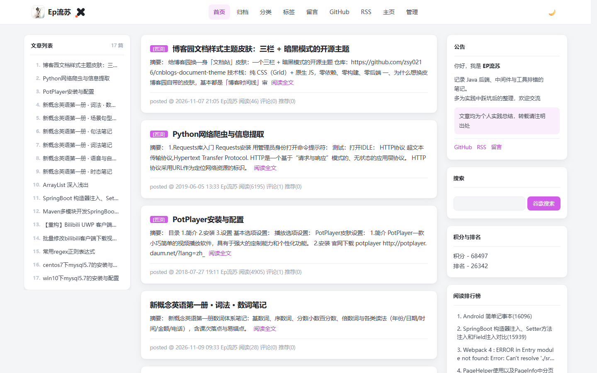
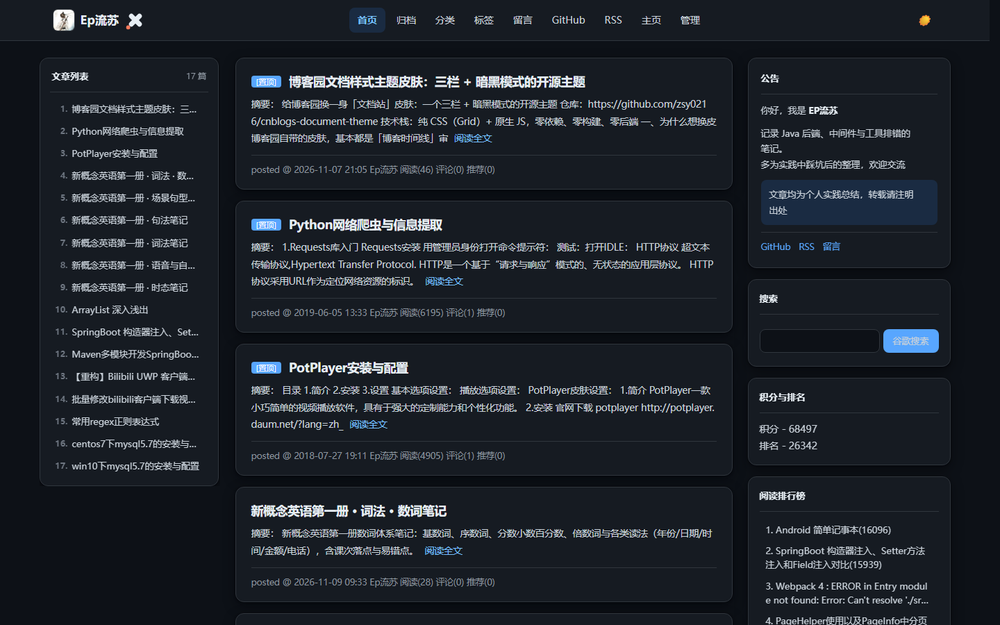
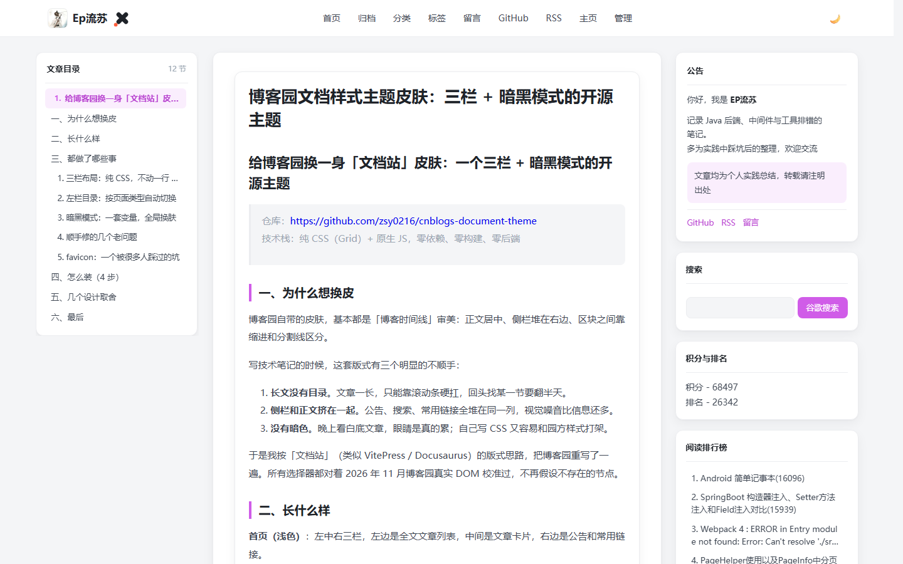

# cnblogs-document-theme · 博客园「文档风」主题

纯白卡片、左中右三栏、粉紫强调色、可定制顶栏、GitHub Dark 暗色模式。
纯 CSS（Grid）+ 原生 JS，零依赖、零构建；基于 2026-11 实测的博客园真实 DOM 重写，不假设不存在的节点。

- **三栏靠 CSS**：左栏文章列表/目录、中栏正文、右栏侧栏卡，首帧就是终态，切页不塌
- **左栏自动目录**：文章页按 H1–H4 生成，列表页生成文章索引，归档页生成年月胶囊
- **归档补成全站时间线**：博客园只有按月归档，主题把全部月份拼成一条线
- **暗色模式**：配色对齐 GitHub Dark，跟随系统或手动切换，选择记在本地
- **后台只贴两个字段**：之后改配色、改逻辑、改菜单，只替换一个 js 文件

## 效果预览

| 首页（浅色） | 首页（暗色） |
|:---:|:---:|
|  |  |

文章页（左侧根据正文 H1–H4 自动生成目录）：



## 安装

> ⚠️ **第 0 步（最重要）**：设置 → 皮肤 → 选择 **`Custom`（自定义）**，否则后续全部不生效。

托管版：后台贴**两个**字段（CSS 32 KB + 页首 2.2 KB），再上传**一个** js（70 KB）。
之后改配色、改目录逻辑、改菜单，**只替换那个 js，不用再进后台**。

| 贴哪 | 用哪个文件 | 大小 |
|:---|:---|---:|
| 设置 → **页面定制 CSS 代码** | `dist/paste/样式.css` | 32 KB |
| 设置 → **页首 HTML 代码** | `dist/paste/页首.html` | 2.2 KB |
| 设置 → **页脚 HTML 代码** | **全选删除，必须清空** | — |
| 设置 → **公告** | 全选删除（公告由配置渲染） | — |
| 文件 → 上传 | `dist/document-theme.js` | 70 KB |

### 四个步骤

1. **先清空页脚与公告**
   两个字段都 `Ctrl+A` → `Delete` → 保存。⚠️ 不能省：页脚里若残留旧版内联脚本，
   它会自己建一套右栏，和新版同时跑，怎么贴都不对。

2. **贴 CSS（32 KB）**
   页面定制 CSS 代码 → 全选删除 → 粘贴 `样式.css` 全文 → 保存。
   首行是 `html{--qb-field:1}`（给 js 的标记，别删），后面是完整主题样式。
   这份样式会在 `<head>` 里阻塞渲染，**首帧就是最终外观**，不会先画一遍博客园原生皮肤。

3. **贴页首（2.2 KB）**
   页首 HTML 代码 → 全选删除 → 粘贴 `页首.html` 全文 → 保存。
   内容是：归档页标记、顶栏外壳占位、`window.LS_CONFIG`、一行同步加载 js 的代码。

4. **上传 js**
   我的博客 → 文件 → 上传 `document-theme.js`，覆盖同名旧文件。
   直链固定为 `https://blog-static.cnblogs.com/files/blogs/<你的博客ID>/document-theme.js`，
   页首里那行 `document.write` 指向它。换了博客就同步改这一行。

最后前台 `Ctrl + F5` 强刷。

### 装完怎么确认

打开任意页面 → `Ctrl+U` 看源码，四个关键词：

| 搜什么 | 期望 |
|:---|:---|
| `--qb-field` | 1 处（第 1 行） |
| `@view-transition` | 1 处 |
| `document-theme.js` | 1 处（在 `document.write` 里） |
| `qb-right` | **0 处**（有的话说明页脚旧脚本没清干净） |

页面上看：左栏有内容、右栏有公告和搜索/积分/排行榜、顶栏 59px。逐项验收清单与排错表见[安装-详解](docs/安装-详解.md)。

<details>
<summary>不想上传文件？三字段全内联（备选）</summary>

先跑 `python _dev-tools/gen-deploy.py --mode inline` 生成四份，再贴 CSS / 页首 / 页脚三个字段（公告清空）。
页面不发出任何主题请求，代价是**每次改脚本要重贴 36 KB 页脚**。

完整步骤见[备选-内联安装](docs/备选-内联安装.md)。

</details>

## 配置项

改配色或关掉某个功能，不必碰源码：在**页首字段**里那个 `window.LS_CONFIG = { ... }` 加键保存即可。

```js
window.LS_CONFIG = {
  accent: '#d05ce8',        // 强调色
  dark: 'auto',             // 'auto' 跟随系统 | 'on' | 'off'
  nav: {
    brand: 'Ep流苏',
    home: 'https://www.cnblogs.com/你的博客名/',
    logo: 'https://…jpg',   // logo: '' 只显示文字
    links: [
      { t: '首页', h: 'https://www.cnblogs.com/你的博客名/' },
      { t: '归档', h: 'https://www.cnblogs.com/你的博客名/p/archive/2026/11' },
      { t: 'GitHub', h: 'https://github.com/zsy0216', b: 1 }   // b:1 = 新窗口
    ]
  },
  notice: {
    title: '公告',
    html: '<p>你好，我是 <b>你的名字</b></p>'
  }
};
```

| 键 | 默认 | 说明 |
|:---|:---|:---|
| `accent` | `''` | 强调色，如 `#d05ce8`。留空沿用 CSS 里的值；`--accent-deep` 与 `--accent-soft` 自动派生 |
| `dark` | `'auto'` | `auto` 跟随系统 / `on` 默认暗色 / `off` 默认浅色。用户手动点过开关后以他的选择为准 |
| `backToTop` | `true` | 右下角回到顶部按钮（带阅读进度环） |
| `pager` | `true` | 列表页分页整理（隐藏上方那份，只留下方一条） |
| `archive` | `true` | 归档页聚合成全站时间线 |
| `archiveTtl` | `24` | 归档单月缓存有效期（小时）；篇数一变仍会立即失效 |
| `nav` | 内置 9 个菜单 | 顶栏。`{ brand, home, logo, mark, dark, links: [{ t, h, b, on }] }`，`links` 整体替换 |
| `notice` | 内置原公告 | 公告。`{ show, title, html }`；`show:false` 隐藏，`html:''` 退回博客园「公告」字段原文 |

`nav.links` 每条：`t` 文字、`h` 地址、`b` 新窗口、`on` 强制高亮（默认按当前地址自动高亮）。
公告的 `.qb-notice-tip` / `.qb-notice-links` 是内置样式类，颜色走变量，暗色自动跟随。
菜单与 logo 的完整写法见[自定义顶栏](docs/自定义顶栏.md)。

优先级：**内置默认值 < `LS_CONFIG` < 用户手动选择（仅暗色一项）**。不给配置时，行为与逐项默认一致。

> **命名说明**：`LS` = 流苏（LiuSu）的拼音首字母。v6.29 及以前叫 `window.QB_CONFIG`，两个名字等价，
> **同时写时 `LS_CONFIG` 优先**，老配置一个字都不用改。
> CSS 类名（`.qb-nav` / `.qb-pager`…）和 `localStorage` 键（`qb-dark`、`qb-arc-v3:`）仍是 `qb-` 前缀，
> 升级不会丢用户已存的暗色选择和归档缓存。

## 文档

| 文档 | 内容 |
|:---|:---|
| [安装-详解](docs/安装-详解.md) | 验收清单、排错表、切页不闪的逐帧实测与修法 |
| [备选-内联安装](docs/备选-内联安装.md) | 不上传文件、三字段全内联的装法与排错 |
| [自定义顶栏](docs/自定义顶栏.md) | 菜单、logo、favicon、顶栏样式 |
| [布局与左栏目录](docs/功能-布局与目录.md) | 三栏原理、适配页面、左栏目录、一篇一卡、右栏精简 |
| [归档时间线](docs/功能-归档时间线.md) | 归档总览页怎么补出来、缓存新鲜度、侧栏异步的稳定性处理 |
| [分页与滚动](docs/功能-分页与滚动.md) | 列表页分页整理、吸顶行为、回到顶部按钮 |
| [开发指南](docs/开发指南.md) | 源码结构、构建与版本管理、压缩、验证脚本、文件清单 |
| [推广文](docs/promo-post.md) | 发到博客园 / CSDN 的介绍文章（配图 + 安装步骤） |

本地 `preview/home-v7.html` / `preview/post-v7.html` 是离线预览页（线上 DOM + 主题 CSS 合成），可直接用浏览器打开看效果。

## 回滚

清空「页面定制 CSS 代码」「页首 HTML 代码」「页脚 HTML 代码」三个字段，即恢复博客园默认外观。
旧版 v6.28 已封存在 tag `v6.28`，需要时从仓库取出重贴。

## 许可

[MIT](LICENSE)
